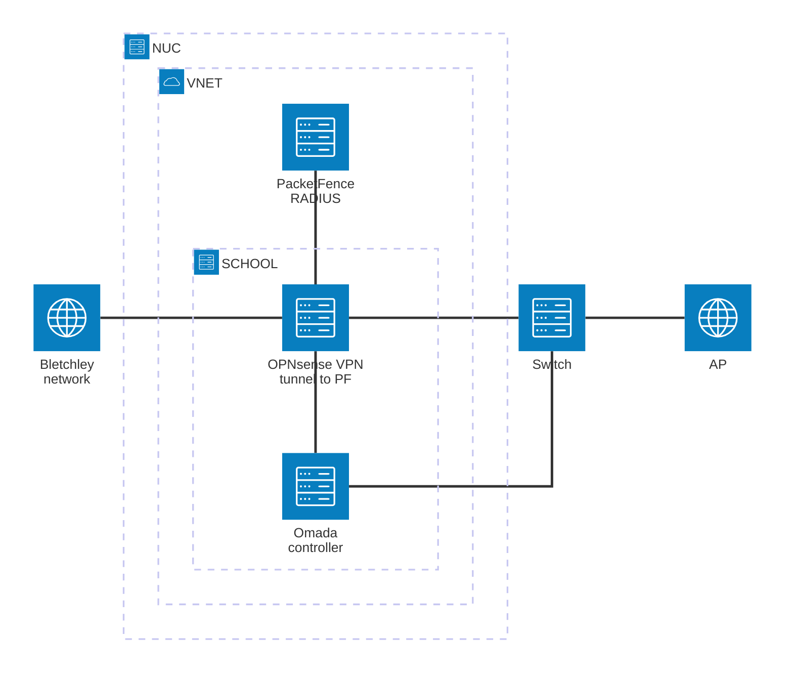

## Introduction 
This proof of concept shows how an organisation can move RADIUS authentication for its wired and wireless network to the cloud. The goal is to replace a local RADIUS server with a centrally hosted PacketFence instance that performs 802.1X network access control (NAC) for devices connecting through an Omada switch and access point.

### Topology

