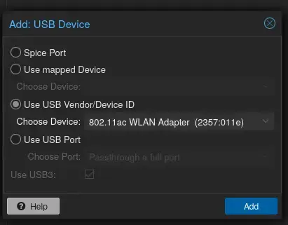

## USB Wi-Fi adapter in Proxmox

To test wireless 802.1X from a VM, pass a USB Wi-Fi adapter through to it. In Proxmox, select the VM and go to _Hardware > Add > USB Device_, choose **Use USB Vendor/Device ID** and pick the adapter (here `802.11ac WLAN Adapter (2357:011e)`). Using the vendor/device ID instead of the port means it keeps working if you plug it into a different USB port.

