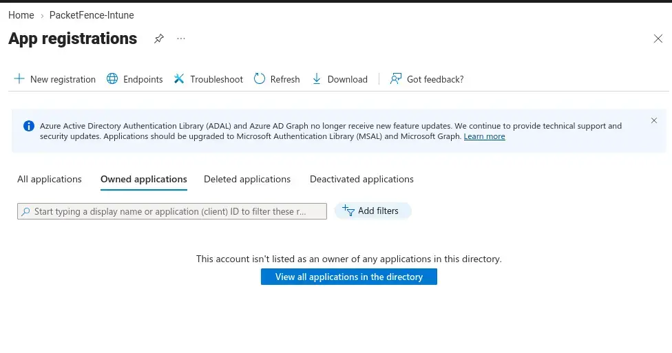
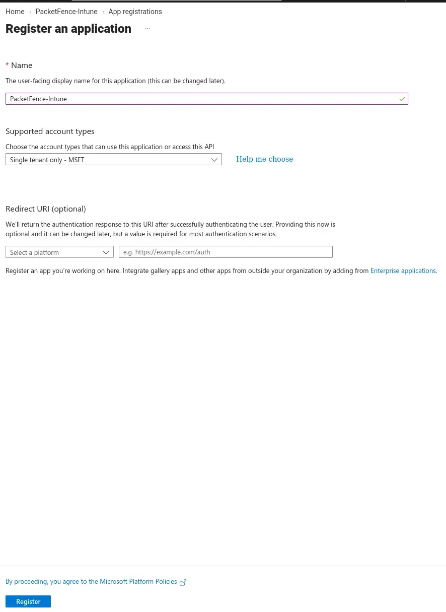
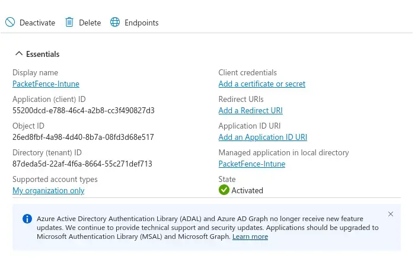
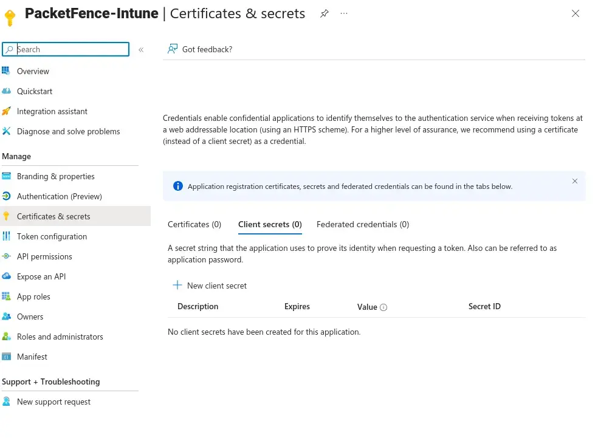
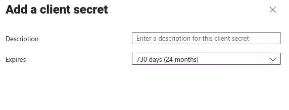
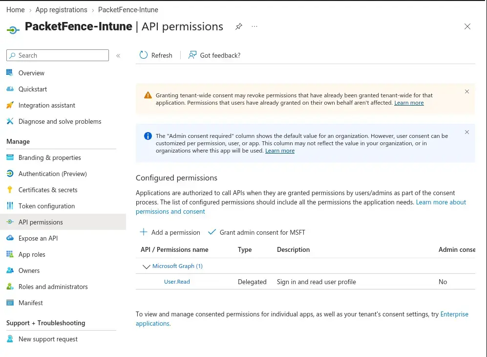
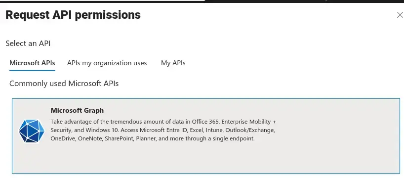
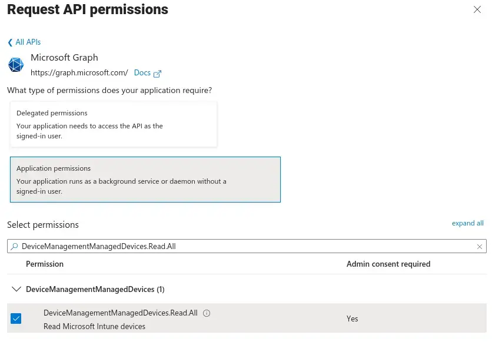
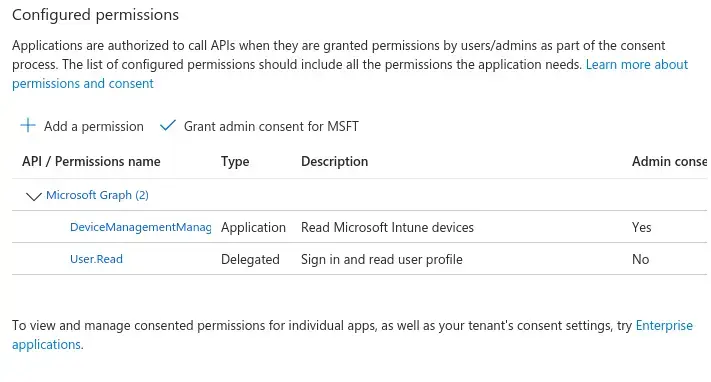
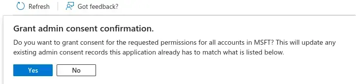

## Overview

PacketFence can check whether a device is enrolled and compliant in **Microsoft Intune** before giving it network access. It does this by calling the Microsoft Graph API, so it needs its own identity in Entra ID: an **app registration** with a client secret and read access to managed devices.

At the end of this page you will have three values for PacketFence:

| Value         | Where to find it                          |
| ------------- | ----------------------------------------- |
| Tenant ID     | App overview, _Directory (tenant) ID_     |
| Client ID     | App overview, _Application (client) ID_   |
| Client secret | _Certificates & secrets_, **Value** column |

You need an account with at least the **Application Administrator** role to register the app, and **Global Administrator** (or Privileged Role Administrator) to grant admin consent.

---

## Register the application

**Step 1, App registrations:** in the [Entra admin center](https://entra.microsoft.com) go to _Identity > Applications > App registrations_ and click **New registration**.



---

**Step 2, Register an application:**
- **Name:** `PacketFence-Intune`.
- **Supported account types:** _Single tenant only_. Only devices in your own tenant need to be checked.
- **Redirect URI:** leave empty. PacketFence signs in as a background service (client credentials), not through a browser.

Click **Register**.



---

**Step 3, Copy the IDs:** the overview page shows the **Application (client) ID** and **Directory (tenant) ID**. Copy both, you will paste them into PacketFence later.



---

## Create a client secret

**Step 4, Certificates & secrets:** open _Certificates & secrets > Client secrets_ and click **New client secret**.



---

**Step 5, Add a client secret:** give it a description (for example `packetfence`) and pick an expiry. The maximum is 730 days (24 months). Put a reminder in your calendar, because the Intune check silently stops working when the secret expires.



<Callout type="warn" title="Copy the Value, not the Secret ID">
After you click **Add**, the table shows a **Value** and a **Secret ID**. PacketFence needs the **Value**. It is only shown once: if you leave the page without copying it, delete the secret and create a new one.
</Callout>

---

## Grant API permissions

**Step 6, API permissions:** open _API permissions_. A new app only has the delegated `User.Read` permission, which is not enough. Click **Add a permission**.



---

**Step 7, Microsoft Graph:** select **Microsoft Graph**.



---

**Step 8, Application permission:** choose **Application permissions** (not Delegated), because PacketFence runs without a signed-in user. Search for and tick `DeviceManagementManagedDevices.Read.All` (_Read Microsoft Intune devices_), then click **Add permissions**.

This is read-only access: PacketFence can see devices and their compliance state, but cannot change or wipe them.



---

**Step 9, Grant admin consent:** the new permission shows _Admin consent required: Yes_. Click **Grant admin consent for &lt;tenant&gt;**.



Confirm with **Yes**. The status column should now show a green check for `DeviceManagementManagedDevices.Read.All`.



---

## Verify with curl

Before configuring PacketFence, check that the app can get a token and read Intune devices. `read -rs` reads the secret without echoing it or saving it in your shell history.

```bash
read -rs -p "Secret: " SECRET; echo
TOKEN=$(curl -s -X POST "https://login.microsoftonline.com/<tenantID>/oauth2/v2.0/token" \
  -d "client_id=<clientID>" \
  --data-urlencode "client_secret=$SECRET" \
  -d "scope=https://graph.microsoft.com/.default" \
  -d "grant_type=client_credentials" | grep -o '"access_token":"[^"]*' | cut -d'"' -f4)
echo "${TOKEN:0:20}..."
# output: eyJ0eXAiOiJKV1QiLCJu...
```

If you get a token, query the first three managed devices:

```bash
curl -s -H "Authorization: Bearer $TOKEN" \
  "https://graph.microsoft.com/v1.0/deviceManagement/managedDevices?\$top=3"
```

A JSON list of devices means the app registration works. Common errors:

- **Empty token:** wrong tenant ID, client ID, or you used the Secret ID instead of the Value.
- **`403 Forbidden`** on the device query: admin consent was not granted, or the permission was added as Delegated instead of Application.

Next: [connect PacketFence to Entra ID](/docs/EntraID-Connection).
