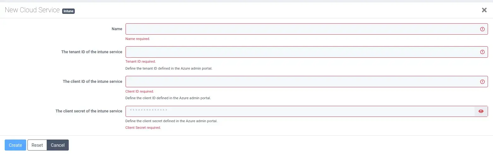
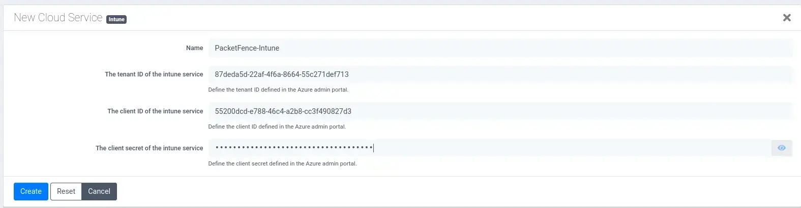

## Prerequisites

- A working [Entra ID app registration](/docs/EntraID-Configuration) with admin consent for `DeviceManagementManagedDevices.Read.All`.
- The **tenant ID**, **client ID** and **client secret value** from that page.
- PacketFence must be able to reach `login.microsoftonline.com` and `graph.microsoft.com` over HTTPS (port 443).

---

## Add the Intune cloud service

**Step 1, New Cloud Service:** in the PacketFence admin UI open _Cloud Services_ under _Configuration > Integration_ and click **New Cloud Service > Intune**. All four fields are required.

---

**Step 2, Fill in the Entra ID values:**

| Field         | Value                                                      |
| ------------- | ---------------------------------------------------------- |
| Name          | `PacketFence-Intune`                                       |
| Tenant ID     | _Directory (tenant) ID_ from the app overview              |
| Client ID     | _Application (client) ID_ from the app overview            |
| Client secret | The secret **Value** (not the Secret ID)                   |

Click **Create**.

<Callout title="Secrets in the PacketFence config">
PacketFence stores the client secret in its configuration under `/usr/local/pf/conf`, which is tracked in git when _Track configuration_ is enabled. Restrict access to the server, and when the secret expires, create a new one in Entra ID and update it here.
</Callout>

---

## Troubleshooting

If PacketFence cannot query Intune, run the [curl test](/docs/EntraID-Configuration#verify-with-curl) from the PacketFence server itself. That tells you whether the problem is the credentials (no token), the permissions (`403`), or the network (connection timeout).
