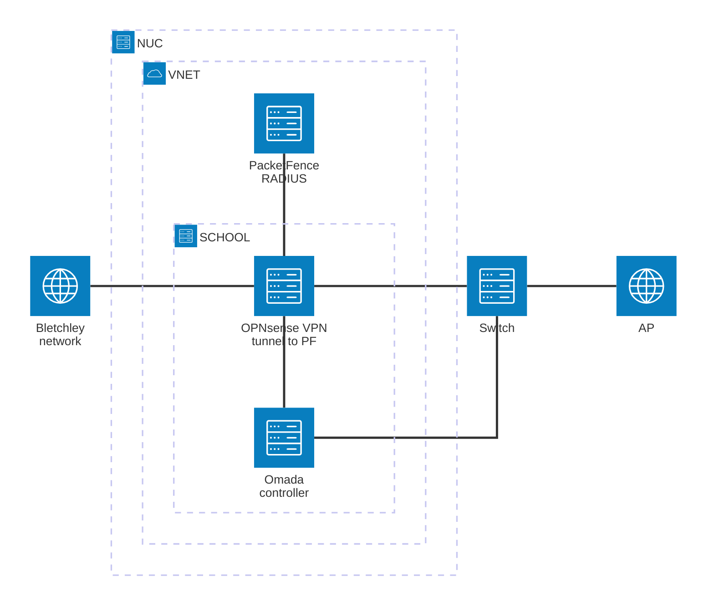

## Introduction
This proof of concept shows how an organisation can move RADIUS authentication for its wired and wireless network to the cloud. The goal is to replace a local RADIUS server with a centrally hosted PacketFence instance that performs 802.1X network access control (NAC) for devices connecting through an Omada switch and access point.

## Topology

<Cards>
  <Card title="Omada SDN controller" href="/docs/omada-tp-link-install">
    Install the TP-Link Omada controller, register an account and adopt devices.
  </Card>
  <Card title="PacketFence" href="/docs/packetfence-install">
    Prerequisites and the installation wizard for the PacketFence NAC.
  </Card>
  <Card title="RADIUS connection" href="/docs/radius-connection">
    Point Omada at PacketFence and register the switch as a RADIUS client.
  </Card>
  <Card title="Entra ID configuration" href="/docs/EntraID-Configuration">
    Register an app in Entra ID with read access to Intune devices.
  </Card>
  <Card title="Entra ID connection" href="/docs/EntraID-Connection">
    Add the Intune cloud service in PacketFence.
  </Card>
  <Card title="Test devices" href="/docs/Devices">
    Pass a USB Wi-Fi adapter through to a VM for 802.1X testing.
  </Card>
</Cards>
