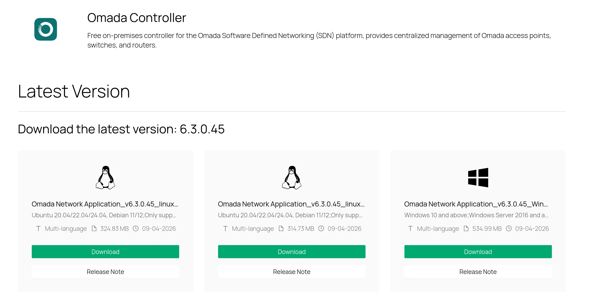
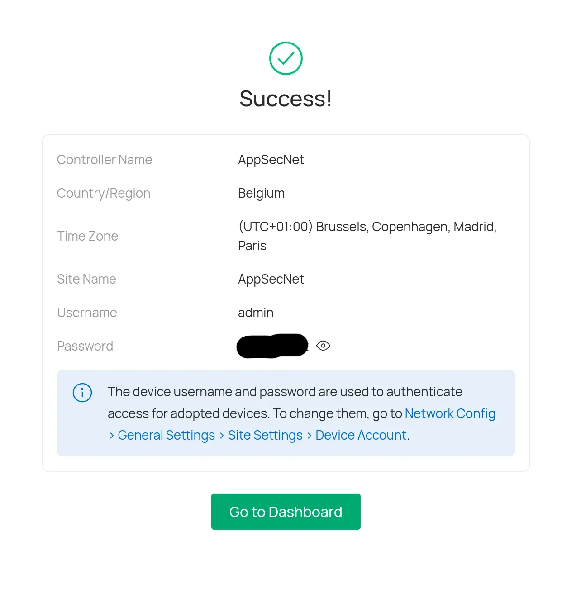
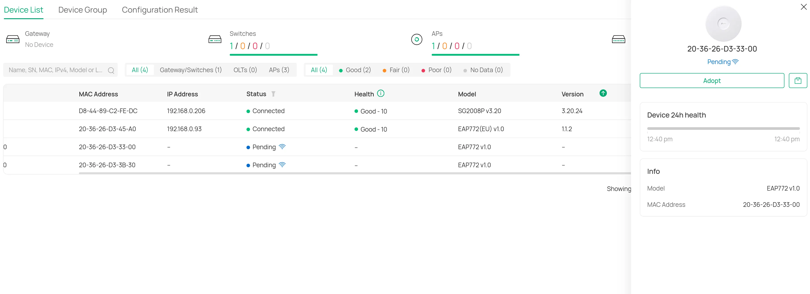

## Install Omada SDN controller:

Download the latest version (6.3.0.45 at the moment) from the TP-Link Omada download page. Pick the build for your OS: Linux (Ubuntu 20.04/22.04/24.04, Debian 11/12) or Windows 10 and up.

You can run it on a personal PC, but this is not advised. The controller has to be online and connected to the network at all times for management, adoption, and provisioning to keep working. A small always-on host (a Proxmox VM or LXC in your lab, a Raspberry Pi, or a mini PC) is the better choice.

---

## Register account (cloud/local):

During the first-run wizard you create a local admin account, or sign in with an existing TP-Link cloud account.
The final “Success!” screen shows the **device username and password**. These are what the controller uses to authenticate to adopted devices, so note them down in your password manager. You can change them later under _Network Config > General Settings > Site Settings > Device Account_.

---

## Adopt devices:
The controller must reach the devices at layer 2/3 over Ethernet to discover them. Devices show up under _Device List_ with the status **Pending**; select one and click **Adopt**.

The reason the APs (EAP772) also appear is that the switch (SG2008P) is already adopted and connected, so the APs plugged into its ports are discovered through it. This makes adopting them easier.

Pending devices that have no IP address yet (like your two EAP772s) simply haven’t received a lease or aren’t reachable from the controller’s network. Check that the PoE port is powered, DHCP is working, and the controller is on the same VLAN or can reach it.

After adoption, a device goes through _Adopting > Provisioning > Connected_. Once it reads Connected with a health status, it’s managed.

