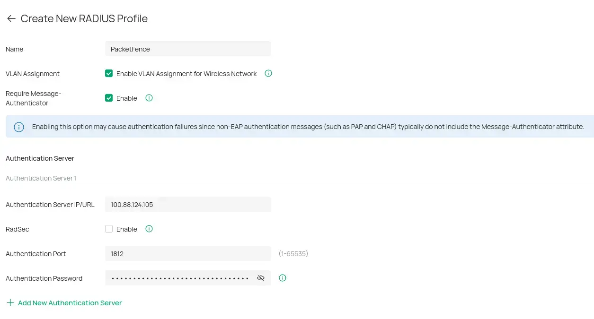
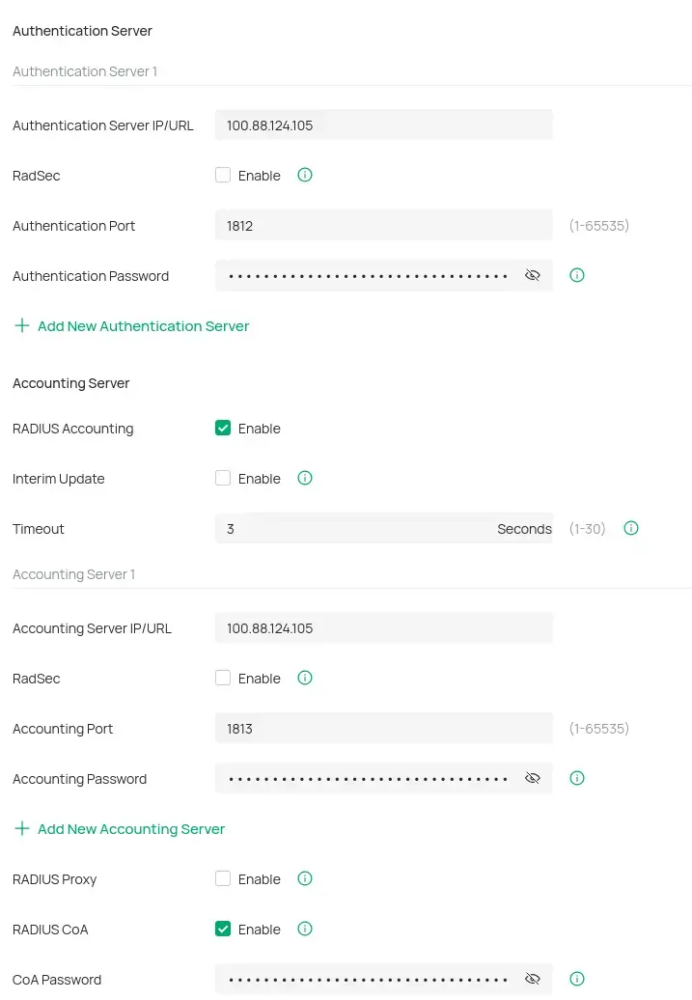
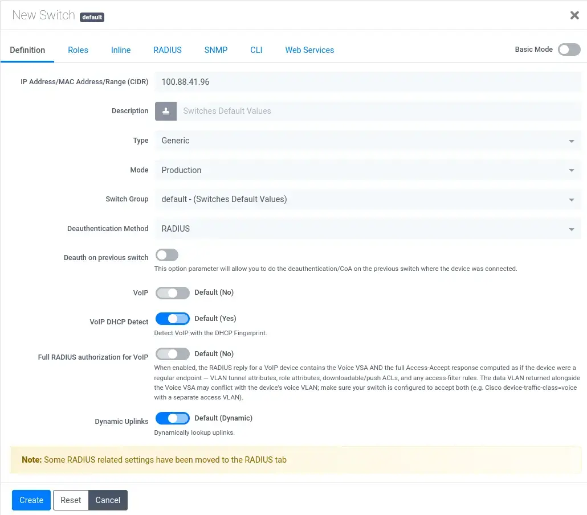
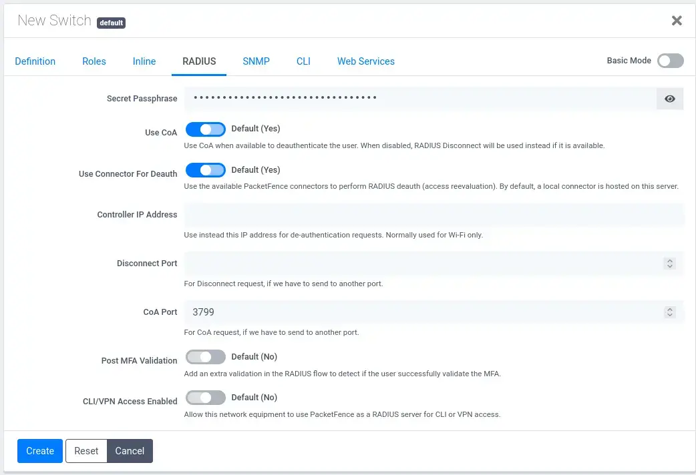

## Overview

RADIUS needs to be configured on both sides:

- **Omada** gets a RADIUS profile that sends authentication and accounting requests to PacketFence.
- **PacketFence** gets a switch entry for the Omada device, so it accepts requests from that IP and knows the shared secret.

The **shared secret** must be exactly the same on both sides. Generate one long random string (32+ characters) and store it in your password manager before you start.

| Value           | Used in this lab                    |
| --------------- | ----------------------------------- |
| PacketFence IP  | `100.88.124.105` (over the tunnel)  |
| Omada device IP | `100.88.41.96`                      |
| Auth port       | `1812`                              |
| Accounting port | `1813`                              |
| CoA port        | `3799`                              |

---

## Omada: create a RADIUS profile

In the Omada controller open the site's _RADIUS Profile_ page (under the profile settings) and click **Create New RADIUS Profile**.

**Step 1, General:**
- **Name:** `PacketFence`.
- **VLAN Assignment:** enable it. PacketFence returns the VLAN (registration, isolation or production) in the RADIUS reply, and the AP needs this option to apply it.
- **Require Message-Authenticator:** enable it. This protects against the BlastRADIUS attack. 802.1X (EAP) always includes the attribute, so it only breaks plain PAP/CHAP, which we don't use.

**Step 2, Authentication Server:**
- **IP/URL:** the PacketFence IP.
- **RadSec:** leave off. The traffic already goes through the VPN tunnel.
- **Port:** `1812`.
- **Password:** the shared secret.

---

**Step 3, Accounting Server:**
- Enable **RADIUS Accounting**, so PacketFence knows when a device connects and disconnects.
- **IP/URL:** the PacketFence IP, **port** `1813`, same shared secret.
- Leave **Interim Update** off and the **timeout** at 3 seconds.

**Step 4, CoA:**
- Leave **RADIUS Proxy** off.
- Enable **RADIUS CoA** and set the **CoA password** to the shared secret. Change of Authorization lets PacketFence kick a client off or move it to another VLAN after it registers or gets a violation, without the user having to reconnect manually.

Save the profile, then select it in the WLAN (_WPA-Enterprise_) and in the switch port 802.1X settings.

---

## PacketFence: add the switch

In the PacketFence admin UI go to _Configuration > Policies and Access Control > Network Devices > Switches_ and click **New Switch > default**.

**Step 1, Definition tab:**
- **IP Address:** the Omada device IP. PacketFence only answers RADIUS requests from known IPs.
- **Type:** change it from _Standard Switch (template based)_ to `Generic`. There is no dedicated Omada module, and Generic works with standard RADIUS attributes.
- **Mode:** `Production`.
- **Deauthentication Method:** `RADIUS`.
- Leave the rest on the defaults.

---

**Step 2, RADIUS tab:**
- **Secret Passphrase:** the same shared secret as in the Omada profile.
- **Use CoA:** Yes (default).
- **CoA Port:** `3799`, matching the CoA setting in Omada.

Click **Create**.

